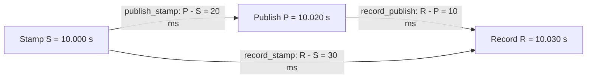

# rosbag-timeline

Inspect **embedded stamps, publication timestamps, and recording timestamps** in
ROS 2 MCAP bags. A local browser viewer and a headless statistics CLI; **no ROS 2
installation, message packages, Node.js, build server, or network connection is
needed at runtime**. Install Python dependencies once. Python 3.10+.

This is a working first release, tested with synthetic MCAPs. It is not yet a
published PyPI project, and the optional ROS wrapper has not been run under ROS.

## Install and run

Install [uv](https://docs.astral.sh/uv/getting-started/installation/), then clone
the repository (or extract the source ZIP). Run the `uv` commands below from the
repository directory:

```bash
git clone https://github.com/PastorD/rosbag-timeline.git
cd rosbag-timeline
uv sync --extra stats

uv run rosbag-timeline view /path/to/recording.mcap
# Or load all .mcap splits in a bag directory:
uv run rosbag-timeline view /path/to/rosbag_directory
```

`uv sync` creates and manages the project environment and installs the package;
`uv run` uses it without shell activation. The `stats` extra adds Matplotlib for
image reports. Use `uv sync` without that extra if you only need the viewer or
JSON statistics. Commands that export images below explicitly request the extra.
The first sync also creates `uv.lock` locally, recording the resolved versions.
See [uv's project guide](https://docs.astral.sh/uv/guides/projects/) for details.

The viewer opens `http://127.0.0.1:8765`. Everything stays local. An initial
10-second window and up to 12 topics are selected, so opening a large bag does
not immediately request every message. Select more topics or click Full range
when desired. Stop with Ctrl+C. `uv run python -m rosbag_timeline` works too.
Once dependencies are installed, `uv run --no-sync rosbag-timeline ...` runs
without checking or updating the environment, including when working offline.

For a headless workstation, use `--no-browser`, and forward port 8765 with SSH:

```bash
ssh -L 8765:127.0.0.1:8765 your-workstation
# On that workstation:
uv run rosbag-timeline view recording.mcap --no-browser
```

Try the included small example:

```bash
uv run rosbag-timeline view examples/demo.mcap --nodes examples/demo.nodes.json
# Or generate another valid bag, including point-cloud payloads:
uv run rosbag-timeline demo demo.mcap --messages 20000 --payload-bytes 12000
uv run rosbag-timeline view demo.mcap --nodes demo.nodes.json
```

## The three times are different

| Symbol | Source | What it means |
|---|---|---|
| S | Selected `header.stamp`, `stamp`, or custom `builtin_interfaces/Time` field | Application-defined time, often sensor acquisition time. It can be stale, copied through a pipeline, future-dated, or on a hardware/simulation clock. |
| P | MCAP `publish_time` | Recorded publication/source timestamp. Its clock and fidelity depend on the recorder and middleware. It is **not guaranteed to be `node.get_clock().now()` at publish**. |
| R | MCAP `log_time` | Recorded receive/log timestamp. Used as the receiving time and as the range-filter clock in this package. It is not the time the bytes finished reaching disk. |

MCAP requires unavailable publication time to fall back to log time. Older ROS 2
recorders used that fallback; newer implementations can preserve middleware send
and receive timestamps. Equal P and R are reported as **possibly a fallback**,
not proof of zero communication delay. A stored P of zero is treated as missing.
There is no metadata in ordinary MCAP that proves every timestamp's clock domain.

Do not interpret P−S or R−S as latency until their clocks and the stamp's meaning
are compatible. In particular, a simulated ROS stamp and wall-clock middleware
publication time cannot be subtracted meaningfully without a clock mapping.
Negative values are preserved. Zero stamps are retained but excluded from gaps
and periods by default; `--include-zero-stamps` treats zero as a valid epoch.

## How the calculations work

The examples below use one topic and timestamps on a compatible clock. Absolute
times are shown in seconds and differences in milliseconds; the implementation
subtracts **integer nanoseconds** before converting values for display.

### Differences within one message

For message A, the embedded stamp is 10.000 s, publication time is 10.020 s, and
recording time is 10.030 s. Each arrow names a separate metric:



The diagram shows timestamp differences, not a proportional time scale or proof
that the stamp was created by the publishing node. When all three timestamps are
available, `R - S = (P - S) + (R - P)`; here, `30 ms = 20 ms + 10 ms`.

In **topic mode**, the default block spans S to P (20 ms for A); choosing S to R
shows the full 30 ms. In **node mode**, the default line starts at S on the
candidate publisher row and ends at R on the recorder row. Selecting P as the
start instead shows the 10 ms publication-to-recording interval. The recorder's
R does not provide receipt times for other subscriber nodes.

### Periods between consecutive messages

Now include message B from the same topic/type. Messages are ordered by **R**
within the selected recording-time window:

| Message | Stamp S (s) | Publish P (s) | Record R (s) |
|---|---:|---:|---:|
| A | 10.000 | 10.020 | 10.030 |
| B | 10.100 | 10.130 | 10.145 |

The first three metrics compare timestamps **within** a row; the last three
subtract the previous row's timestamp **in the same column**:

| Metric | A | B |
|---|---:|---:|
| `publish_stamp` = P - S | 20 ms | 30 ms |
| `record_stamp` = R - S | 30 ms | 45 ms |
| `record_publish` = R - P | 10 ms | 15 ms |
| `stamp_period` = current S - previous S | No previous message | 100 ms |
| `publish_period` = current P - previous P | No previous message | 110 ms |
| `record_period` = current R - previous R | No previous message | 115 ms |

For example, B's recording period is `(10.145 - 10.030) s = 115 ms`.
The increasing stamp age explains why its recording period is longer than its
stamp period: `115 ms = 100 ms + (45 - 30) ms`. A period value belongs to the
**later message**, so selecting the 115 ms period highlights B.

### From values to statistics and highlighted messages

For `record_stamp`, the values above are `[30, 45] ms`. They produce:

| Statistic | Calculation | Result |
|---|---|---:|
| Count | Number of valid values | 2 |
| Mean | `(30 + 45) / 2` | 37.5 ms |
| Population standard deviation | `sqrt(((30 - 37.5)^2 + (45 - 37.5)^2) / 2)` | 7.5 ms |
| Minimum / maximum | Smallest / largest value | 30 / 45 ms |

The first pass computes these aggregates, using online updates rather than
retaining every value. A second pass counts values in histogram bins. Selecting
the bin containing 45 ms highlights B in the timeline; selecting all bins
highlights A and B. Bin matching uses `lower <= value < upper` on the selected
topic and metric. In density mode, the viewer highlights matching counts instead
of drawing an individual event for each message.

Filtering happens **before** period and aggregate calculations. For example, a
recording-time window `[10.100, 10.200) s` contains only B: its `record_stamp`
mean becomes 45 ms and no period is available, because A is outside the window.
The CLI's `--start` and `--end` are seconds relative to the bag's earliest R;
the absolute window above must be converted to that origin before using them.

### Negative, missing, and fallback timestamps

* **Future stamp:** with S = 10.200 s, P = 10.170 s, R = 10.180 s, the metrics
  are `publish_stamp = -30 ms`, `record_stamp = -20 ms`, and
  `record_publish = 10 ms`. Negative values stay in statistics, and the stamped
  topic interval points backward. Check clock alignment and stamp meaning.
* **Missing stamp:** P and R still give `record_publish` and their own periods;
  S-dependent values are absent, not zero. A missing/invalid S also breaks stamp
  periods on both sides of that message; the next valid S is not paired across
  the gap. A zero S behaves this way unless `--include-zero-stamps` is enabled.
* **Missing publication time:** a stored P of zero removes P-dependent values;
  `record_stamp` and available S/R periods can still be computed.
* **Recorder fallback:** P = R gives `record_publish = 0`, but P may be a copy of
  R rather than a measured send time. This is not evidence of zero transport
  delay. If S is valid, `publish_stamp` and `record_stamp` are equal in this case.

## Viewer

* **Topics:** one row per topic/type. A stamped message has a directional interval
  from S to P (default) or S to R. A circle marks its stamp, a diamond marks P,
  and a vertical tick marks R. Messages without an eligible stamp get a tick.
  Orange denotes an interval going backward in time. Endpoints outside the view
  are clipped; they do not rescale the view.
* **Overlap:** intervals are greedily packed into six lanes per topic. Further
  overlaps use transparency. Zoom in to separate events. Above 20,000 messages
  in a requested view, counted density bins replace individual events; this is
  explicitly labeled and is not a silently truncated or sampled event list.
  Density bands show timestamp envelopes, not individual causal relationships.
* **Nodes:** one row per known/candidate publisher and the bag recorder. Lines
  start at the carried S (fallback P, then R), or at P if selected, and end at R
  on the recorder row. A stamp drawn on a publisher's row is not a measurement
  of when that node created the stamp. Arrowheads can be disabled.
* **Filters:** fuzzy subsequence search anywhere in topic name or message type;
  multiword terms are ANDed. Search narrows the checklist; “Select matches”
  adds its matches to the selected topics. Node filtering narrows topics by their
  candidate publishers or recorder. It cannot separate unidentified publishers
  sharing one channel.
* **Navigation:** edit start/end in seconds relative to the earliest recorded
  message, drag horizontally to zoom, Shift-drag to pan, or Ctrl/Command-wheel
  to zoom. Hover for exact integer timestamps; click to pin the inspector.
* **Statistics:** click Compute statistics, choose a topic and one of six metrics,
  then click or drag histogram bins. Matching messages in that topic are
  highlighted, including exact matching counts in density mode. Changing the
  time window or topic/node filters invalidates the statistics.

**Time filtering is anchored to R, inclusive at start and exclusive at end.**
The message is selected if its recording time is in the window, even if its S
or P is outside it. A message with R outside the window is not loaded just
because its stamp interval crosses it. MCAP's indexes cannot answer arbitrary
stamp-overlap queries without first inspecting the relevant messages. Widen the
record window when investigating long delays.

## Statistics without the viewer

```bash
# One six-panel PNG per topic, plus statistics.json and summary.csv:
uv run --extra stats rosbag-timeline stats recording.mcap --output timing-report

# Select a record window and fuzzy topic/type matches:
uv run --extra stats rosbag-timeline stats recording.mcap --start 20 --end 80 \
  --search PointCloud2 --output lidar-report --format png --format svg

# Exact topic selection is repeatable:
uv run --extra stats rosbag-timeline stats recording.mcap --topic /imu --topic /odom \
  --output selected-report

# Machine-readable reports without Matplotlib:
uv run rosbag-timeline stats recording.mcap --json-only --output timing-json
```

| Metric key | Calculation |
|---|---|
| `publish_stamp` | P − S: age of the carried stamp at publication |
| `record_stamp` | R − S: age of the carried stamp at recording |
| `record_publish` | R − P: observed source-to-recorder gap |
| `stamp_period` | Sᵢ − Sᵢ₋₁, in recording order |
| `publish_period` | Pᵢ − Pᵢ₋₁, in recording order |
| `record_period` | Rᵢ − Rᵢ₋₁, in recording order |

For each topic and metric: count, mean, **population** standard deviation,
minimum, maximum, negative/zero counts, and a histogram. Periods include only
pairs within the selection; an invalid/missing timestamp breaks that pair. They
are not sorted by stamp, so stamp regressions remain visible. Splits and channels
with the same topic/type are merged; interleaved publishers can therefore affect
the periods. Counts of absent, zero, ambiguous, and undecodable stamps accompany
the statistics. There are no sampled means or approximate percentiles.

Statistics make two bounded-memory passes over the selected timestamp index:
online moments and extrema first, exact histogram counts second. They never
create a list of all messages or deserialize point clouds. `--bins` changes the
headless histogram resolution (1–1000). Every bin includes its lower endpoint
and excludes its upper endpoint; the last edge is strictly above the maximum.

## Embedded schemas and custom stamp fields

The schema comes from the MCAP, not from installed ROS interfaces. Both
`ros2msg` bundles and `ros2idl` bundles are parsed with **rosbags**. A CDR cursor
then skips only the fields preceding the selected Time. Standard Header-first
messages, including PointCloud2 and Image, need only the first 12 serialized
bytes to extract their stamp, regardless of the payload size.

Selection rules: prefer `header.stamp`, then root `stamp`, then a unique nested
Time outside arrays. Arrays are **not silently reduced to their first entry**.
Use a per-topic override for TFMessage or other multi-stamp messages:

```bash
uv run rosbag-timeline info recording.mcap
uv run rosbag-timeline view recording.mcap \
  --stamp '/tf=transforms[0].header.stamp' \
  --stamp '/custom=measurement.acquisition_time'

# Suppress a misleading stamp:
uv run --extra stats rosbag-timeline stats recording.mcap --stamp '/custom=none' --output report
```

`info` shows discovered candidate paths and schema errors without indexing normal
indexed message chunks. An override must end in `builtin_interfaces/Time`, with
`int32 sec` and `uint32 nanosec`. This release selects **one timestamp per
message**. For messages containing many independent measurements, explicitly
choose which stamp to analyze; multi-stamp expansion is not implemented.

All recorded topics can be listed and their P/R times displayed even if their
payload cannot be decoded. Stamp extraction supports plain **CDR1, little or big
endian**, ordinary ROS primitive fields, strings, arrays, sequences and nested
structures. Missing schema dependencies, non-CDR encodings, XCDR2/parameter-list
encodings, unsupported IDL constructs or unsupported primitives such as wide
strings encountered before the stamp produce a visible error/no-stamp status.
This is schema-driven support for arbitrary normal ROS 2 message definitions,
not a claim of universal DDS serialization support. Content following the stamp
is intentionally not validated. Chunk CRC verification is available separately.

## What node information is needed?

An ordinary rosbag2 MCAP channel describes a **topic and type**, not a publisher
node, and recording a topic does not record when each subscriber took it.
Neither `header.frame_id` nor a topic namespace identifies the publishing node.
MCAP message `sequence` is optional and is not a portable DDS identity by itself.

For useful bag-only node rows, capture a graph while recording:

```bash
# In a sourced ROS 2 environment, use the Python interpreter used by ROS:
uv run --python /usr/bin/python3 rosbag-timeline capture-graph nodes.json --wait 3 \
  --recorder /my_bag_recorder

# The viewer itself needs no ROS environment:
uv run rosbag-timeline view recording.mcap --nodes nodes.json
```

`/usr/bin/python3` is typical for an apt-installed ROS distribution; substitute
your ROS interpreter if different. The ROS environment must provide `rclpy` and
its dependencies. The standalone `uv` setup does not install ROS.

Or write a small mapping:

```json
{
  "recorder": "/bag_recorder",
  "topics": {
    "/lidar/points": {
      "publishers": ["/lidar_driver"],
      "subscribers": ["/localization", "/bag_recorder"]
    }
  }
}
```

The snapshot records fully qualified node names, endpoint GIDs and endpoint
types. A sole publisher is a **candidate based on the snapshot**, not per-message
proof. Several publishers produce an explicitly ambiguous row; missing mappings
produce unknown rows. Declared subscriber names are preserved in the snapshot
but are not assigned fabricated receive times. Historical graph changes are not
reconstructed. This release draws bag arrows to the recorder only.

To draw actual publisher→subscriber events, additional recording/instrumentation
must preserve:

1. Timestamped publisher/subscriber endpoint→node mappings, including GIDs.
2. Per-message publisher identity and a correlatable message identifier, typically
   writer identity plus publication sequence information where available.
3. A timestamp for each subscriber receive/take or callback entry, with the event
   being measured explicitly defined. These are different moments.
4. A common clock domain or a measured mapping between host clocks and ROS time.

`ros2_tracing`/CARET or a custom instrumented recorder can supply parts of this;
exact availability depends on middleware and tracepoints. Importing trace/receipt
events is a future extension, not an implemented feature in this release. A graph
snapshot alone cannot recover those events from an existing bag.

## Performance and implementation choices

| Part | Implementation and reason |
|---|---|
| Schemas / orchestration | Python + rosbags parsers: portable, installation with uv, no compiled ROS message dependencies. |
| Bag access | MCAP summary/chunk index; memory-mapped uncompressed chunks and memoryview record slicing. Zstd/LZ4 use native libraries. |
| Timing extraction | Partial CDR cursor: no complete Python message objects or NumPy point arrays. Primitive sequences before a stamp can be skipped in O(1); variable-size structures must be walked. |
| Cache / queries | SQLite with integer nanoseconds, a `(topic, record time, physical position)` index, bounded insertion batches, WAL and 32 MiB database page cache. |
| Rendering | Plain JavaScript + Canvas, visible row drawing, a 20,000-event limit before density aggregation. No per-message DOM objects and no npm build. |
| Reporting | Streaming moments/histograms; Matplotlib only for headless exports. |

A full C++ reader could increase first-pass extraction throughput, but adds build
and distribution cost. A browser-only TypeScript tool is also feasible with
MCAP/ROS schema libraries, but complicates a headless image CLI and a persistent
disk index. This hybrid keeps installation simple while moving compression,
storage and rendering to mature native/browser implementations.

**Lazy loading:** opening an indexed bag reads its summary. A query selects
overlapping chunks by R and channel, then indexes only the selected channels in
those chunks. A chunk is the cache coverage unit: messages just outside the
requested window may also be cached, but are excluded from the query. Repeating
that window uses the disk cache without revisiting MCAP payloads. Selecting
another channel in a previously visited compressed chunk may decompress it again.

Compressed chunks must be decompressed to reach embedded stamps; payload
deserialization is avoided, decompression is not. Uncompressed files can skip
payload pages through mmap unless CRC validation is enabled. A large chunk sets
the working-memory floor. By default chunks above 512 MiB are rejected with an
actionable error; increase `--max-chunk-mb` only as needed. Caches use a fingerprint
of paths, sizes, modification times, edge bytes and stamp settings. Reopen a bag
after it changes; live-growing bags are not supported.

Bags without usable summary/chunk indexes fall back to scanning their record
layout and discovering schemas at startup. Compressed unindexed bags require
decompression during discovery; they cannot offer instant startup. Finalize and
index recordings for interactive use. Use the MCAP writer's normal indexed
settings when recording. The fallback covers unchunked MCAP as well.

```bash
# Optional: populate the timing cache before opening a whole recording:
uv run rosbag-timeline index recording.mcap

# Only pre-index a relevant topic and time window:
uv run rosbag-timeline index recording.mcap --search lidar --start 20 --end 80

# Alternate cache location and CRC validation:
uv run rosbag-timeline view recording.mcap --cache-dir /fast-disk/timing-cache \
  --validate-crcs
```

Integer nanoseconds are preserved in Python and SQLite. JSON encodes absolute
timestamps and histogram edges as decimal strings. The viewer uses BigInt for
absolute timestamps, then converts relative coordinates to floating point for
pixels. Epoch nanoseconds are never sent through a JavaScript Number. The
storage layer accepts nonnegative MCAP times within signed int64 range.

### Measured synthetic benchmark

See `examples/benchmark.json` for measurements from the development environment:
one million small messages across three topics, Zstd MCAP, no large cloud data.
The reader used about 86 MiB peak process RSS; a one-second/one-topic cold query
read 1 of 77 chunks in about 0.04 s. Remaining indexing took 9.45 s, a cached full
density query 1.03 s, and all six metrics in two passes 16.36 s. The timestamp
cache was about 125 MiB. These numbers do not predict throughput for your storage,
CPU, compression ratio or large payloads.

Reproduce on your computer:

```bash
uv run rosbag-timeline demo million.mcap --messages 1000000
uv run python tests/benchmark.py million.mcap fresh-cache > benchmark.json
```

## Testing and optional ROS wrapper

```bash
uv run --extra stats --extra test pytest -q
uv build
```

Tests cover CDR endian/alignment, negative seconds, nanosecond precision, custom
and IDL schemas, nested arrays, constant-memory skipping of a 24 MiB prefix,
partial decoding, stamp ambiguity, all supported compression modes, unindexed
and unchunked files, split bags, lazy/cache behavior, range boundaries,
histogram selection, and exact statistics.

`ros2/rosbag_timeline_ros` is an optional ament_cmake wrapper. Copy the wrapper
into a ROS workspace's `src`, then build it and source the install **from that
ROS workspace**:

```bash
colcon build --packages-select rosbag_timeline_ros
source install/setup.bash
```

Return to this repository directory, keeping the ROS workspace sourced, and use
the ROS-compatible Python interpreter as described for `capture-graph`:

```bash
uv run --python /usr/bin/python3 ros2 run rosbag_timeline_ros rosbag-timeline view recording.mcap
```

The wrapper deliberately does not install Python dependencies through CMake/rosdep.
`capture-graph` also needs rclpy in that environment. A ROS deployment and a real
hardware recording remain integration checks for the user environment.

## Existing tools and references

* [MOLA rosbag_timing_inspector](https://github.com/MOLAorg/rosbag_timing_inspector)
  is the closest existing match: a Dear ImGui/ImPlot topic timeline, interval
  histograms and statistics, for MCAP and db3. It reads bag timestamps without
  deserializing messages and depends on ROS 2 rosbag2 libraries. Its documented
  feature set does not include embedded-stamp interval blocks or subscriber
  timing reconstruction.
* [Foxglove Plot panel](https://docs.foxglove.dev/docs/visualization/panels/plot)
  supports log, header/custom and publish timestamps, expressions and
  downsampling. Its documented plots are a useful existing alternative, but not
  the paired per-message interval/node view implemented here.
* [PlotJuggler](https://github.com/PlotJuggler/PlotJuggler) provides time-series
  analysis and transformations; [rqt_bag](https://github.com/ros-visualization/rqt_bag)
  provides the familiar per-topic bag timeline. Neither project is being claimed
  to have no possible extension for this task.
* [CARET](https://github.com/tier4/caret) analyzes callback, communication and path
  latency with instrumentation/tracing. It addresses true node/event timing,
  which a normal bag cannot recover on its own.
* [MCAP specification](https://mcap.dev/spec): message times, schema/channel
  records, chunks and indexes.
* [rosbag2 timestamp change, PR #1531](https://github.com/ros2/rosbag2/pull/1531)
  and [current MCAP storage implementation](https://github.com/ros2/rosbag2/blob/rolling/rosbag2_storage_mcap/src/mcap_storage.cpp):
  middleware timestamps and their storage mapping. Check the code/version used
  to create a specific bag before interpreting publication fidelity.
* [rosbags type system](https://ternaris.gitlab.io/rosbags/topics/typesys.html):
  standalone parsing of ROS message definitions.

Apache-2.0. See LICENSE.
